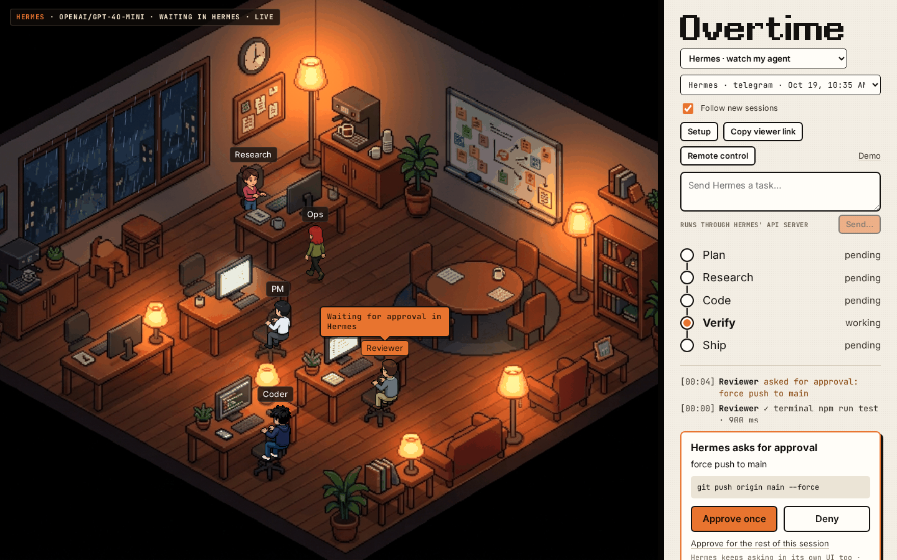
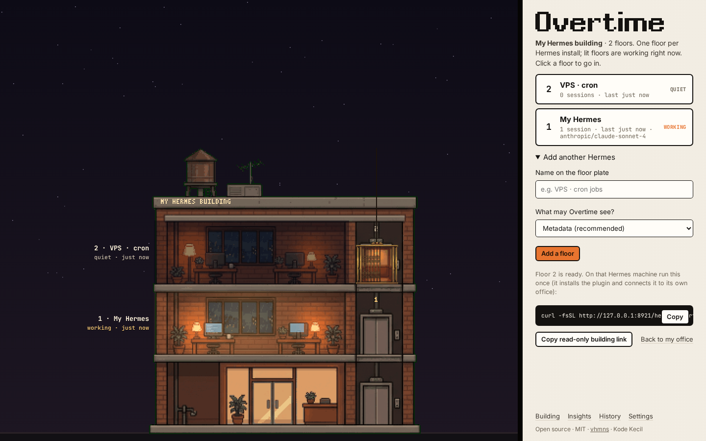
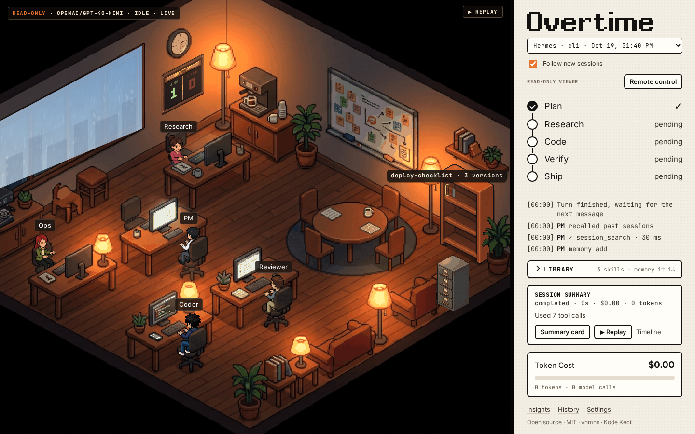
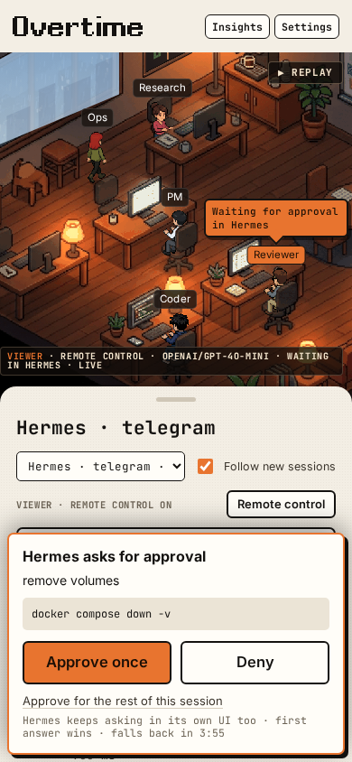
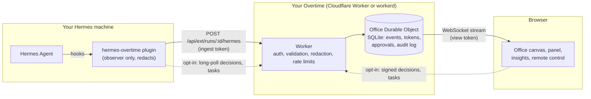

# Overtime

A pixel-art office that shows your [Hermes Agent](https://hermes-agent.nousresearch.com/) working live.

[](https://github.com/vhmns14/overtime/actions/workflows/ci.yml)
[](LICENSE)


Every Hermes session plays out in a small isometric office. Research happens at the Research desk, edits at the Coder's, tests with the Reviewer, deploys with Ops. The plan goes up as stickies on the whiteboard, subagents borrow a free desk with their own name tag, and the cost meter ticks with every model call. When Hermes stops to ask for approval, the office shows it, and if you opt in, you can answer from your phone.

Hermes keeps running where it runs. Overtime only receives events from a small observer plugin, and by default it sees metadata only: tool names, file paths, hosts, durations, tokens and cost. Never prompts, messages, file contents or outputs.

## Screenshots

| Hermes live in the office | Waiting for approval |
|---|---|
|  |  |
| **Several Hermes installs as floors of a building** | **Skills on the bookshelf, memory in the cabinet** |
|  |  |
| **Replay and timeline** | **Cost dashboard and budgets** |
|  |  |
| **Session summary card** | **Approve from a paired phone** |
|  |  |

## Quick start

There are three ways in. None of them needs an account with us; there is no hosted service.

### 1. Try the demo

[`preview.html`](preview.html) is the whole app in one offline file: a recorded real Hermes session (a plan, a subagent, a failing test fixed, an approval in Hermes' CLI), two runs of the built-in team, a sample building, replay and the insights panels. Download it and open it in a browser. It runs in a sandboxed iframe with no network access and no storage.

Or run it from source:

```bash
git clone https://github.com/vhmns14/overtime.git
cd overtime
npm install
npm run dev     # Worker on :8787 + Vite on :5173
```

Open http://localhost:5173 and pick **Demo · a recorded Hermes session**, or **Connect Hermes** if Hermes runs on the same machine.

### 2. Self-host with Docker

```bash
git clone https://github.com/vhmns14/overtime.git
cd overtime
docker compose up -d --build
curl -fsS http://127.0.0.1:8787/api/health
```

This runs the same Worker and SQLite Durable Objects in `workerd`, with state in a Docker volume and no Cloudflare account. The port binds to `127.0.0.1` by default, so put a reverse proxy or tunnel with HTTPS in front of it if Hermes runs on another machine. The step-by-step guide, written so an agent can follow it too, is [docs/SELF_HOST.md](docs/SELF_HOST.md).

### 3. Deploy to Cloudflare

[](https://deploy.workers.cloudflare.com/?url=https://github.com/vhmns14/overtime)

This deploys to your own Cloudflare account. From a clone, `npm run deploy` does the same. Optional secrets are listed in [docs/SELF_HOST.md](docs/SELF_HOST.md#b-cloudflare-workers-deploy-with-wrangler).

## Connect Hermes

Open your Overtime and press **Connect Hermes**. It creates an **office** for that Hermes install and shows the exact line to run on the Hermes machine:

```bash
curl -fsSL https://<your-overtime>/hermes-overtime/install.sh | sh -s -- --url <office url> --token ot_ing_…
# or create a new office and connect in one go:
curl -fsSL https://<your-overtime>/hermes-overtime/install.sh | sh -s -- --server https://<your-overtime> --create
```

The installer downloads the plugin into `~/.hermes/plugins/hermes-overtime/`, writes `OVERTIME_URL`, `OVERTIME_TOKEN` and `OVERTIME_PRIVACY` to `~/.hermes/.env` (mode 600), enables the plugin and sends a test session. Restart Hermes, then check:

```bash
hermes overtime test    # sends a test session
hermes overtime         # prints the office's read-only viewer link
```

The office stays up and picks up every new session on its own: CLI, gateway chats and cron. Hermes builds with outbound webhooks can post to Overtime without the plugin; the Connect screen's **Webhooks** tab has the `config.yaml` block. Any other agent can drive an office through the generic events API ([docs/EVENTS.md](docs/EVENTS.md)).

## Features

**Watch**
- Tool calls map to desks: `web_search` and `read_file` go to Research, `write_file` and `patch` to the Coder, test runs to the Reviewer, `git push`, `docker` and `wrangler` to Ops. The rules are editable.
- Plan steps appear as stickies on the whiteboard. Subagents take the next free desk with their name on the tag.
- A step tracker (Plan, Research, Code, Verify, Ship), a timestamped activity log and a cost meter using Hermes' own per-call estimate.
- A read-only viewer link (`/watch/<office>#v=…`) for anyone you want to show.

**Control** (opt-in on both sides; off by default)
- Approve or deny Hermes gateway approvals from the office or a paired phone. Decisions are HMAC-signed and bound to the exact command. On a timeout or any error the plugin does nothing and Hermes' own prompt carries on.
- Send Hermes a task through its API server (`POST /v1/runs`), with a confirmation step and a local allowlist on the Hermes side.
- Telegram (your own bot) and Web Push notifications for approvals, errors, stuck sessions and budgets, with quiet hours.
- Paired devices with revocable control tokens, one-time pairing links, and a signed, hash-chained audit log.

**Insights**
- Replay any session at 1x to 16x with a scrubber, and export it as GIF, WebM or MP4 from the browser.
- A timeline with filters (tools, errors, LLM, files, subagents, approvals) that jumps the office to an event.
- A summary card per session (PNG or markdown): what was done, files changed, top tools, errors, cost, tokens, models.
- A cost dashboard per day, model and session, with daily and monthly budgets.
- Stuck detection: the same call repeated, repeated failures, silence while a turn runs, cost spikes.

**Office**
- It dims after 2 minutes of quiet and falls asleep after 10. The next session wakes everyone up.
- A wall clock and window light that follow your local time, and a scoreboard of today's sessions.
- Hermes skills as books on a shelf (with versions) and a filing cabinet that glows on memory reads and writes.
- Buildings: several Hermes installs as floors, with a cross-section that shows which floors are working.

**Self-host**
- Docker Compose (`workerd`, SQLite on a volume) or your own Cloudflare account. Nothing is shared with anyone else.
- A one-line `install.sh` for the Hermes side, idempotent and safe to rerun.
- Offices delete themselves after 30 days without events (`EXT_TTL_DAYS`).

Overtime also has a **built-in team** of five agents (PM, Research, Coder, Reviewer, Ops) that can build a static site, or fix a bug in your GitHub repo and open a pull request, using your own OpenAI-compatible key. See [docs/GUIDE.md](docs/GUIDE.md#the-built-in-team).

## How it works



- The plugin batches hook events, trims them to the privacy level you chose (`metadata`, `args` or `full`) and redacts anything that looks like a key on the Hermes machine. The Worker redacts again before storage.
- Each office is one SQLite Durable Object. The ingest token can only write to its own office; the view token can only read.
- The browser rebuilds the office state from events with a pure reducer (`src/ext/`), and the canvas renderer draws it (`src/office/`).

Event schema, limits and the remote-control protocol: [docs/EVENTS.md](docs/EVENTS.md). Source layout and Worker routes: [docs/GUIDE.md](docs/GUIDE.md#architecture).

## Privacy and security

- **Default privacy is metadata:** tool names, file paths, URL hosts, the first words of shell commands, statuses, durations, tokens and cost. `args` and `full` send more, truncated.
- **Secrets are redacted twice,** on the Hermes machine and in the Worker, using one shared pattern list.
- **Tokens are stored as SHA-256 hashes** and compared in constant time. Write-capable tokens are never accepted in query strings.
- **The plugin observes; it cannot act** unless you turn on remote control on both sides. Remote control never approves on its own and never offers "always".
- **Self-hosting** binds to loopback by default, and secrets reach `workerd` through a private env file rather than process arguments.

A full security audit (27 findings fixed, accepted risks listed) is in [docs/SECURITY_AUDIT.md](docs/SECURITY_AUDIT.md). To report a vulnerability, see [SECURITY.md](SECURITY.md).

## Limits

Being upfront about what Overtime does not do:

- **Remote approval works for gateway sessions only.** Hermes 0.19's CLI prompt reads the terminal, so CLI approvals stay in the terminal.
- **Tasks start a new run** through Hermes' API server. Hermes plugins cannot inject a prompt into an existing chat.
- **The approval signing key is derived from the ingest token,** so a compromised Overtime server could forge a decision for an approval that is currently pending. Device-held keys are on the roadmap. Details in the audit.
- **Costs are Hermes' own estimates,** not your provider's bill.
- **Hermes 0.19.0 on PyPI has no outbound webhooks;** use the plugin there.
- **Web Push was tested** against the RFC 8291 test vector and mocked push services, not on a physical phone.
- **Server-side stuck checks** cover silence and budgets. The other heuristics run in the browser.
- **The built-in team** builds static sites and makes small repo changes, with a GitHub fine-grained token (no OAuth app yet).
- **Tested against Hermes Agent 0.19.0.** Newer Hermes builds add hooks Overtime does not use yet.

## Development

Requirements: Node 22, Python 3 for the plugin tests, and optionally Docker.

```bash
npm install
npm run dev              # Worker + Vite with hot reload
npm run typecheck        # app and Worker
npm test                 # Vitest: schema, redaction, reducer, Durable Objects, insights, engine
npm run test:plugin      # pytest for the Hermes plugin (uses uv)
npm run test:e2e         # Playwright, desktop and phone viewports (run npm run build and build:preview first)
npm run build:preview    # rebuild preview.html
```

CI runs the type check, Vitest and pytest on every push and pull request. The full script list is in [docs/GUIDE.md](docs/GUIDE.md#quick-start).

## License

[MIT](LICENSE) © vhmns · Kode Kecil
