# Overtime

**Watch your own Hermes agent work in a pixel-art office.**

Overtime is an open-source web app. Connect the [Hermes Agent](https://hermes-agent.nousresearch.com/) you run on your server and every session plays out live in a small office: research at the Research desk, edits at the Coder's, tests with the Reviewer, deploys with Ops, the plan as stickies on the whiteboard, subagents at borrowed desks with their own name tags, approvals Hermes is waiting for, and what it all costs. Hermes keeps running where it runs; Overtime only receives events.

Overtime also has its own **built-in team** of five agents (PM, Research, Coder, Reviewer, Ops) that can build a static site or fix a bug in your GitHub repo and open a pull request, with approval gates you control.

The first visit opens on **Connect Hermes**. No server yet? Pick **Demo · a recorded Hermes session**: a real session (plan, a subagent, a failing test fixed, an approval in Hermes' CLI) replayed through the same pipeline, fully offline.

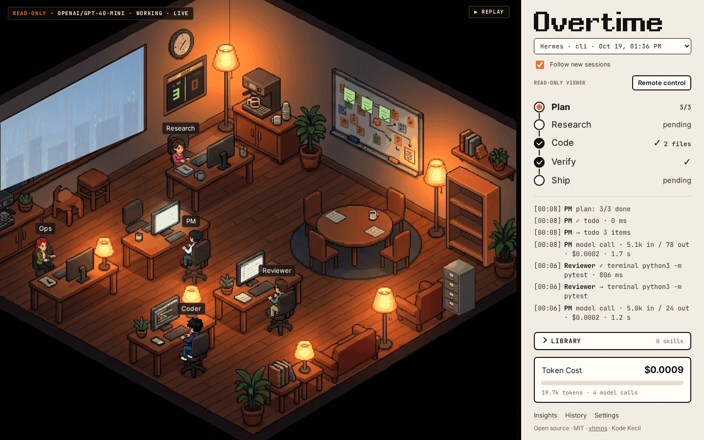

<p align="center">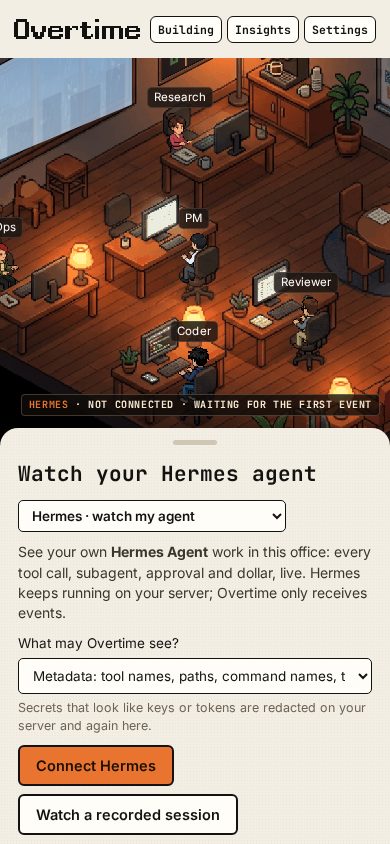 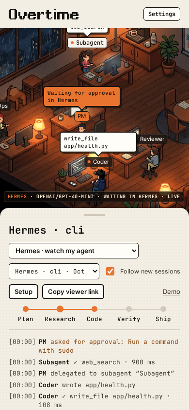 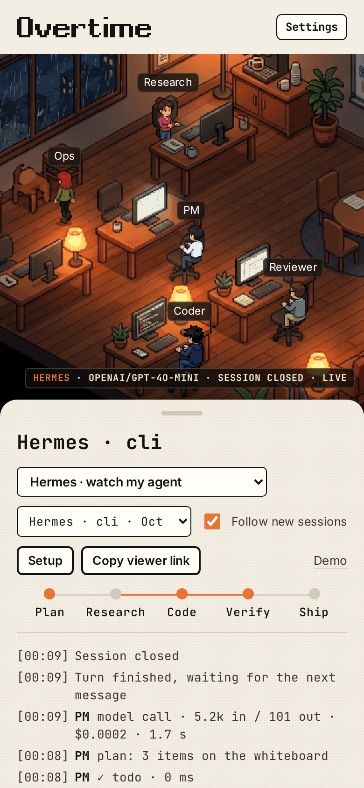</p>

| Connect: one office per Hermes install | Recorded demo: Hermes asks for approval in its own CLI |
|---|---|
| 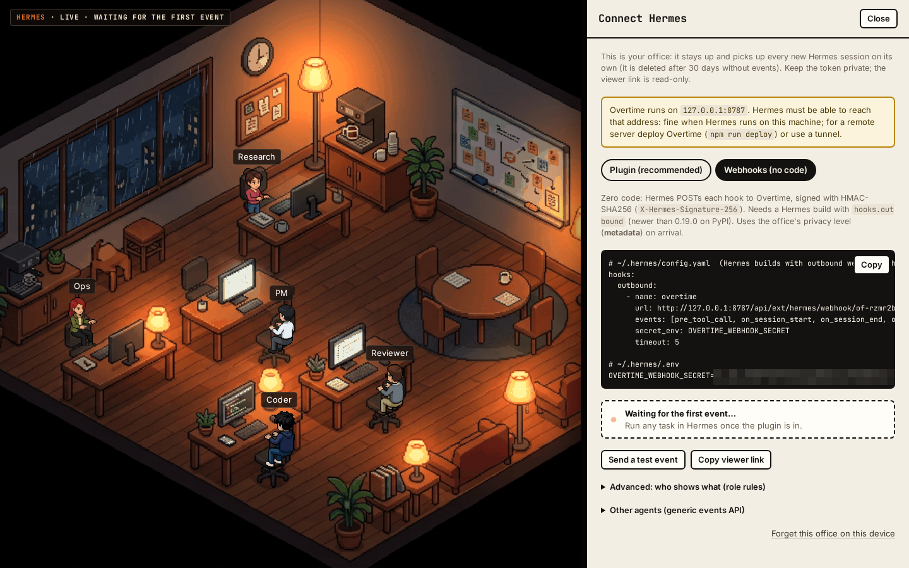 | 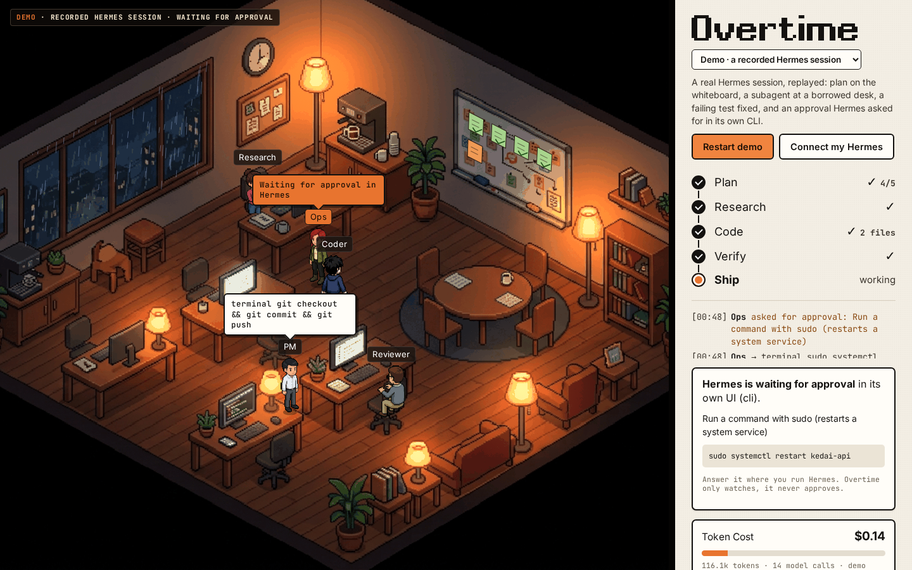 |
| **A subagent borrows the Research desk** | **Read-only viewer link for anyone** |
| 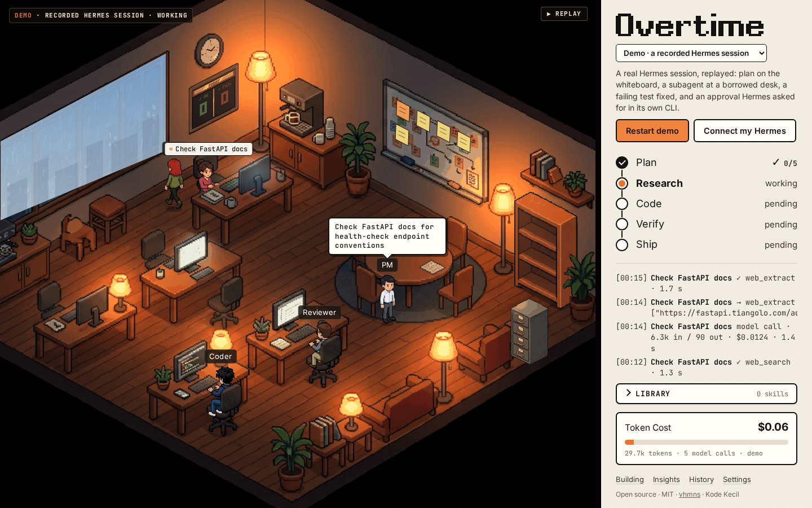 | 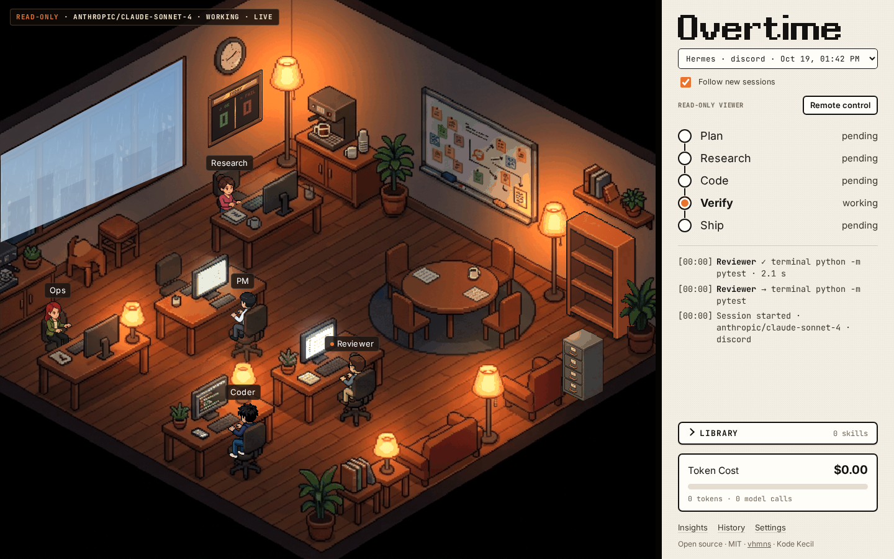 |

## Watch Hermes in Overtime

1. Open Overtime and press **Connect Hermes**. Pick what Overtime may see (*metadata* by default). You get your **office**: it stays up, picks up every new Hermes session on its own (CLI, gateway chats, cron), and is deleted after 30 days without events.
2. On the machine where Hermes runs, paste the setup the screen shows. It looks like this:

   ```bash
   # 1. the plugin: observer hooks only, one Python file, no dependencies
   mkdir -p ~/.hermes/plugins/hermes-overtime
   curl -fsSL https://<your-overtime>/hermes-overtime/plugin.yaml -o ~/.hermes/plugins/hermes-overtime/plugin.yaml
   curl -fsSL https://<your-overtime>/hermes-overtime/__init__.py -o ~/.hermes/plugins/hermes-overtime/__init__.py
   hermes plugins enable hermes-overtime      # if it asks about overriding built-in tools: no

   # 2. point it at your office (values come from the Connect screen)
   cat >> ~/.hermes/.env <<'EOF'
   OVERTIME_URL=https://<your-overtime>/api/ext/runs/<office>/hermes
   OVERTIME_TOKEN=ot_ing_…
   OVERTIME_PRIVACY=metadata
   EOF
   ```

3. Restart Hermes (a new `hermes` session, or restart the gateway) and check: `hermes overtime test` sends a test session; `/overtime` inside a session prints the office's viewer link.
4. Run anything in Hermes. The screen leaves *Waiting for the first event…* and the office comes alive. With **Follow new sessions** on, it jumps to each new session; the picker shows older ones.

**Hermes must be able to reach Overtime.** On one machine, `npm run dev` is enough. For a Hermes on a VPS, deploy Overtime to your Cloudflare account (`npm run deploy`) or expose your local copy through a tunnel.

**No code at all:** Hermes builds with outbound webhooks (`hooks.outbound`) can POST every hook to Overtime themselves, HMAC-signed (`X-Hermes-Signature-256`). The Connect screen's **Webhooks** tab gives you the `config.yaml` block and the secret. Hermes 0.19.0 on PyPI does not have outbound webhooks yet; the plugin works there.

What you see:

| In the office | From Hermes |
|---|---|
| PM thinks, writes the plan on the whiteboard, delegates | model calls, `todo`, `delegate_task`, `clarify`, `memory`, skills |
| Research walks to its desk and types | `web_search`, `web_extract`, `browser_*`, `read_file`, `search_files` |
| Coder | `write_file`, `patch`, `terminal`, `execute_code` |
| Reviewer | `terminal` running tests, lint or type checks (`pytest`, `npm run test`, `ruff`, `tsc`, …) |
| Ops | `git push`, `docker`, `kubectl`, `wrangler`, `systemctl`, `cronjob_*` |
| A subagent takes the next free desk with its name on the tag; PM hands off at the table, and gets it back | `subagent_start` / `subagent_stop` |
| "Waiting for approval in Hermes" bubble and a read-only card | `pre_approval_request`, `on_human_input_request` |
| Step tracker (Plan, Research, Code, Verify, Ship) and the cost meter | derived from activity; cost is Hermes' own estimate per model call |

Rules for who shows what are editable (*Setup → Advanced*). **Overtime never approves anything**: Hermes asks in its own UI; the approval card is read-only, with a clean extension point (`src/ext/approvals.ts`) for remote approval later.

**Privacy and security.** *Metadata* sends tool names, file paths, URL hosts, the first words of shell commands (`git push`, `npm run test`), statuses, durations, tokens and cost: no prompts, messages, file contents, full commands or outputs. *Args* and *full* add more, truncated. Anything that looks like a key or token is redacted on your Hermes machine and again by the Worker before storage. The ingest token can only write to its own office; the viewer link (`/watch/<office>#v=…`) is read-only and keeps its token in the URL fragment. Per-office rate limits, 256 KB/200-event request caps and the full event schema are in [docs/EVENTS.md](docs/EVENTS.md).

**Other agents.** Anything can drive an office through the generic events API: `POST /api/ext/runs/<office>/events` with events like `{"type":"tool.start","session":"s1","data":{"name":"web_search"}}`. Schema: [docs/EVENTS.md](docs/EVENTS.md) and [docs/events.schema.json](docs/events.schema.json).

**Tested against a real Hermes.** Hermes Agent 0.19.0 (PyPI) with `openai/gpt-4o-mini` on OpenRouter, the plugin installed with exactly the curl lines above, a small task (plan, write two files, run pytest) against `wrangler dev`: every hook arrived and the office above is that run. The outbound-webhook path was checked by running Hermes' own serialisation and signing code (`agent/outbound_webhooks.py` from `main`) against a local office.

## Insights: replay, timeline, summary, costs, stuck detection

Open **Insights** (panel footer, or the top bar on a phone) on any Hermes office, the read-only viewer or the recorded demo.

| Replay timelapse with a scrubber and export | Timeline: filter, search, jump the office to an event |
|---|---|
| 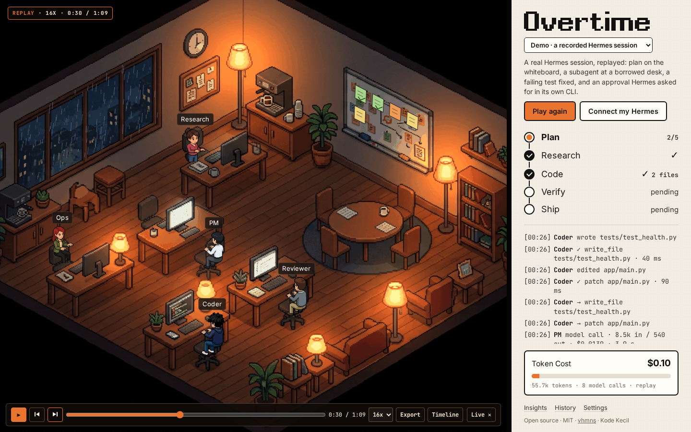 | 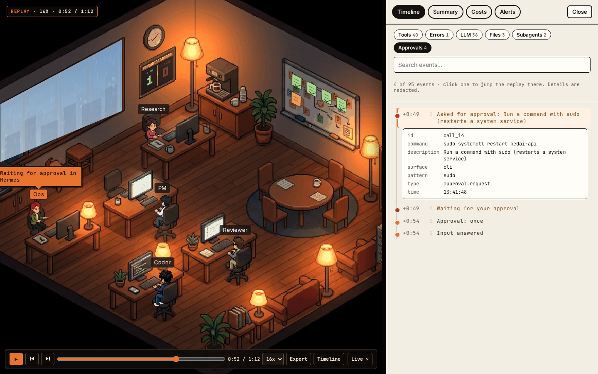 |
| **Session summary card (PNG or markdown)** | **Cost dashboard: per day, per model, per session, budgets** |
| 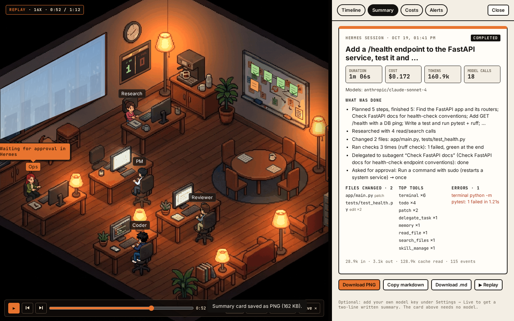 | 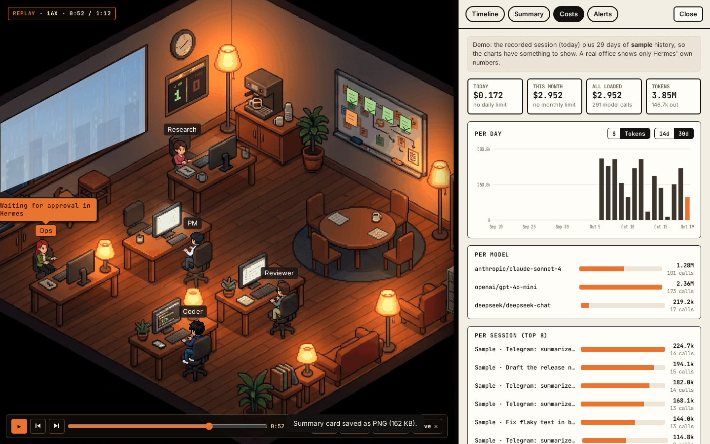 |
| **Stuck detection: a "?" over the agent and a banner** | **Budget banner** |
| 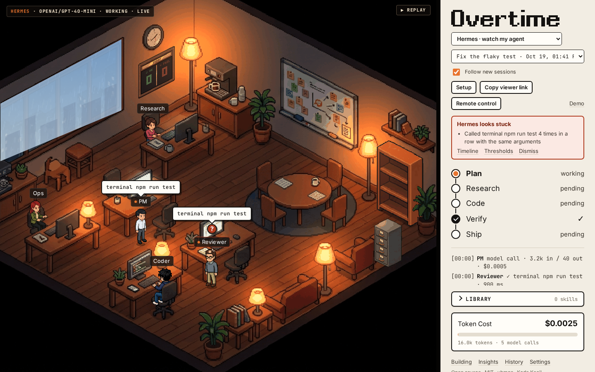 | 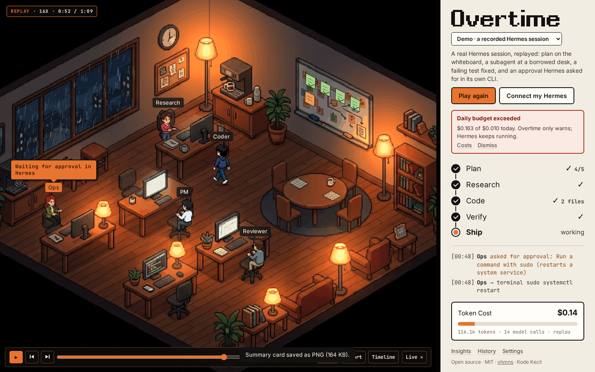 |

A replay exported straight from the browser (GIF, demo session at 16x, caption on):

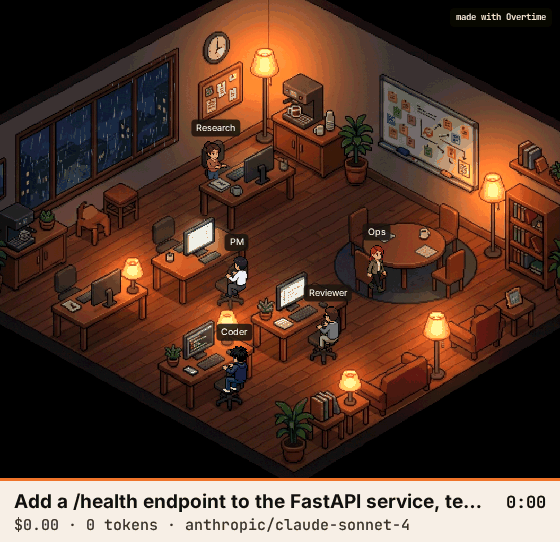

<p align="center">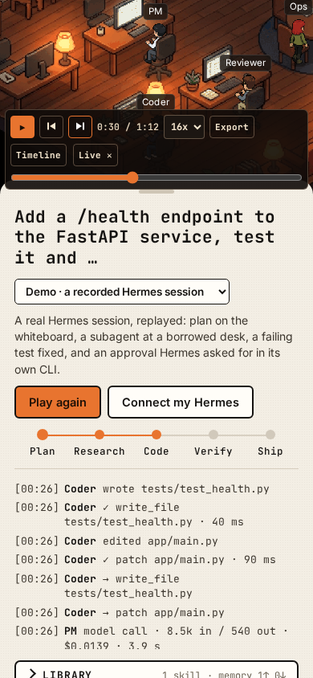 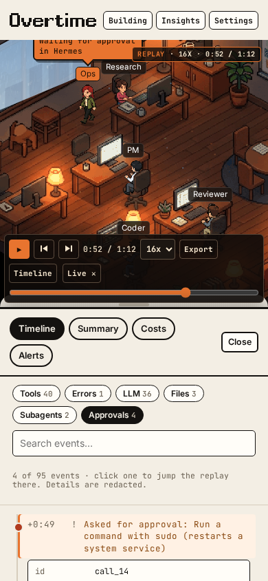 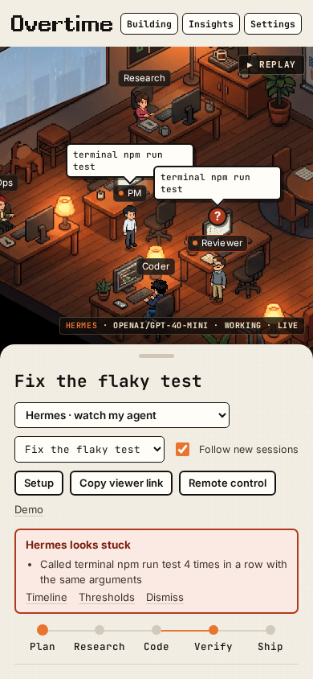</p>

- **Replay** any stored session in the office at 1x, 2x, 4x, 8x or 16x: play/pause, a scrubber with red marks where something failed, jump to the previous/next event, and the panel (steps, log, cost so far) follows. Idle gaps longer than 5 s are squeezed to 5 s, so a session that waited an hour for you does not replay an hour of nothing. Live events keep arriving in the background; **Live ✕** goes back.
- **Export** the replay in the browser: **GIF** (an encoder in `src/insights/gif.ts`: median-cut palette, only the changed box of each frame, identical frames merged, 560 px at 10 fps) or **WebM/MP4** (MediaRecorder on a captured canvas, 960 px at 30 fps; MP4 when the browser can record it). Optional caption (task, cost and tokens so far, clock) and a small "made with Overtime" corner. Long sessions are sped up so a GIF stays under ~20 s and a video under ~40 s. The recorded demo exports to a ~0.6–1 MB GIF.
- **Timeline**: every event of a session, filterable by tools / errors / LLM / files / subagents / approvals, with search over titles and details. Clicking an event pauses the replay exactly there and opens its details, redacted again on display. On a phone the sheet opens under the office so the jump stays visible.
- **Session summary card** when a session ends: what was done (plan progress, files changed, research, test runs, subagents, approvals, all derived from events), files changed, top tools, errors, total cost, tokens, duration and models. **Download PNG**, **copy / download markdown**. If you set your own model key (*Settings → Live*), an optional two-line summary can be written from the derived facts only, never prompts, files or outputs.
- **Cost dashboard**: cost or tokens per day (14 or 30 days, local time), per model and per session, a token breakdown, today and this month. For a real office the numbers come from the Worker's `GET /api/ext/runs/:id/insights` (the newest 20,000 model calls of the whole office), not just what the tab loaded. The demo adds clearly labelled sample history so the charts have something to show.
- **Budgets** per day and per month: an orange banner from 80 %, a red one past the limit, and a `budget.exceeded` signal. Overtime never stops Hermes.
- **Stuck detection** with thresholds you can change (*Insights → Alerts*): the same tool with the same arguments N times in a row, repeated failures, no events for X minutes while a turn runs, a cost spike. The character who was doing it scratches its head under a red "?", a banner says why, and a `session.stuck` signal fires once per streak. Nothing fires while Hermes waits for your approval.
- **Signals for notifications**: `session.stuck` and `budget.exceeded` go through `onSignal()` (`src/insights/signals.ts`) and a `overtime:signal` DOM event, so a notifier (Telegram, web push) can hook in. Fields and rules: [docs/EVENTS.md → Insight signals](docs/EVENTS.md#insight-signals-for-notifications).

Budgets, thresholds and the replay speed are saved in this browser (`localStorage`).

---

## The built-in team

Five agents take a task like *"Build a landing page for Kopi Senja"* and turn it into a real static site, or take *"Fix: cart total ignores item quantity"* on **your existing GitHub repo** and open a real pull request. You watch them walk to their desks and type, meet at the round table for handoffs, put tickets on the whiteboard and grab coffee when they're idle. When a decision matters, they stop and wait for you. Two recorded demos (a landing page; a bug fix that ends in a PR on a mocked GitHub) replay through the real engine, no key needed. To run your own tasks on any OpenAI-compatible model, **bring your own key**.

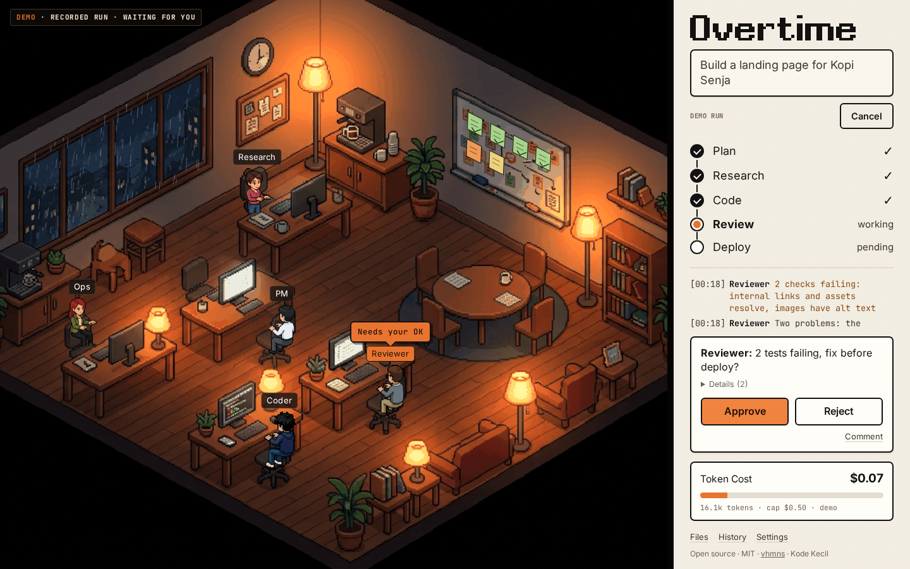

<p align="center">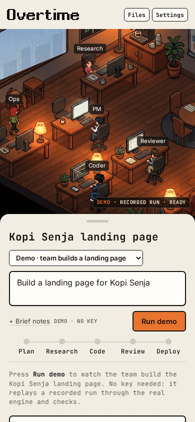 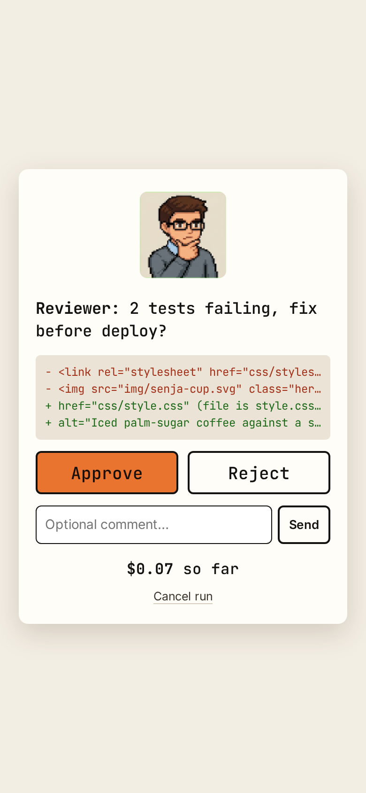</p>

| Files with diffs between Coder iterations | Sandboxed preview served at `/p/<runId>/` |
|---|---|
| 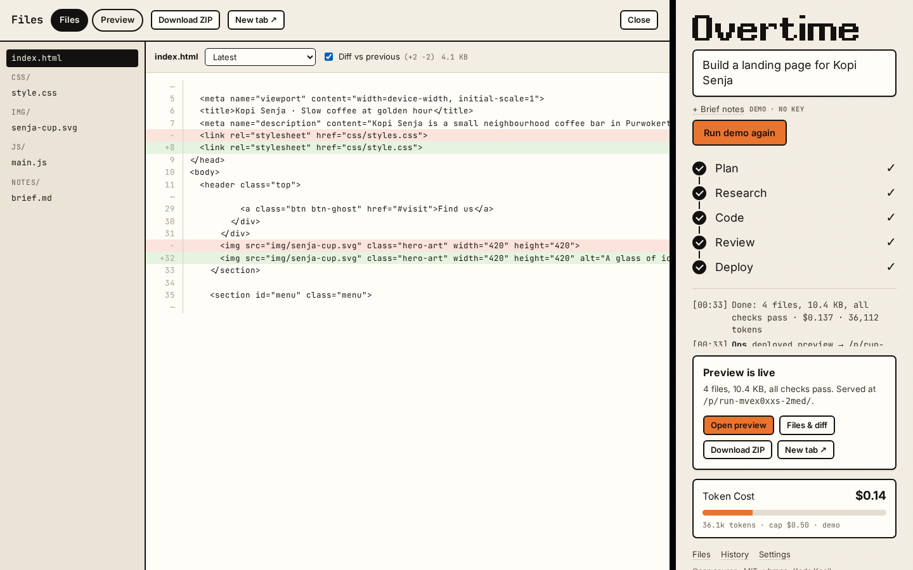 | 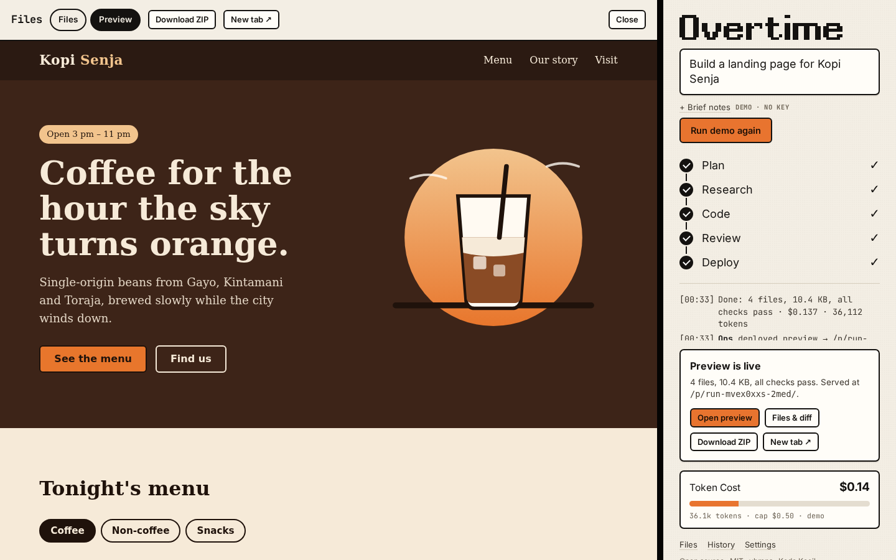 |

### Repo mode: work on an existing repo, open a PR

| Connect GitHub with a fine-grained token | Ops asks before opening the PR |
|---|---|
| 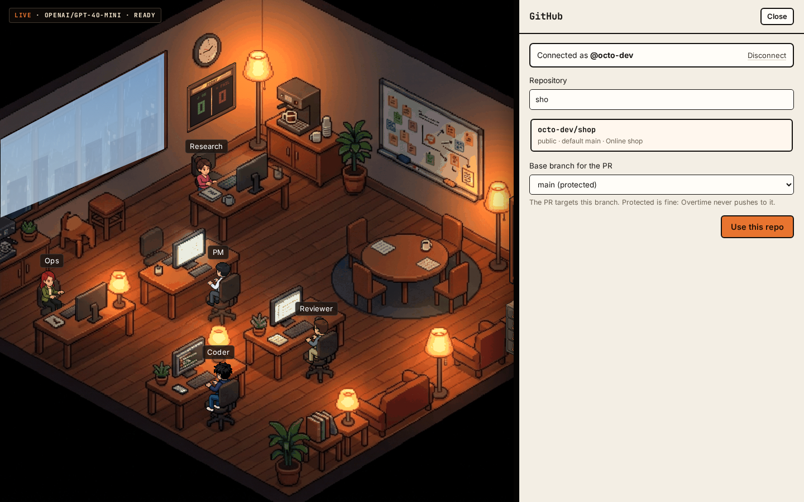 | 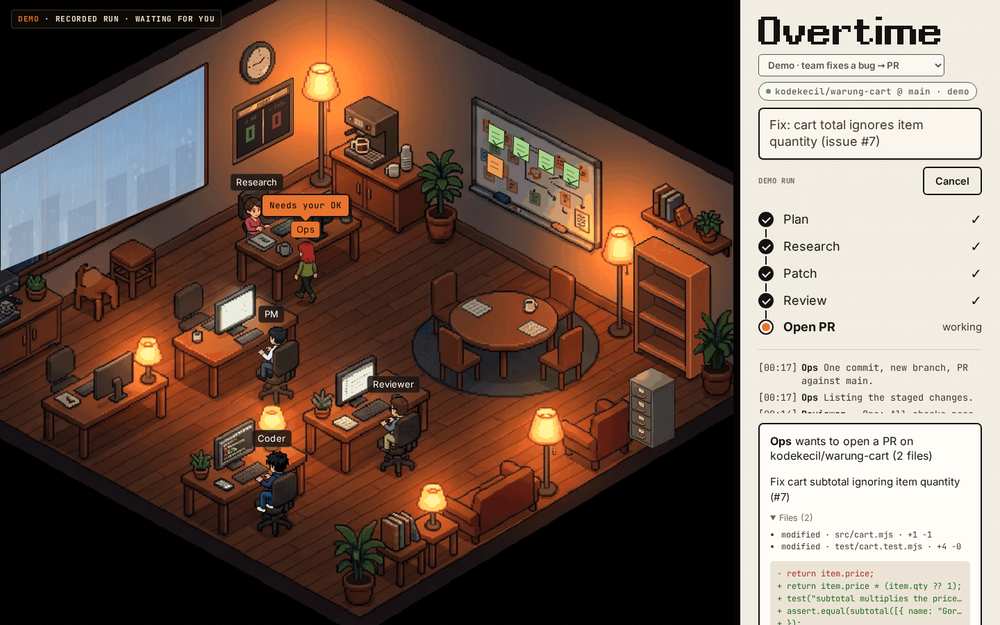 |
| **Per-file unified diff vs. the base branch** | **PR opened: link in the panel, sticky on the whiteboard** |
| 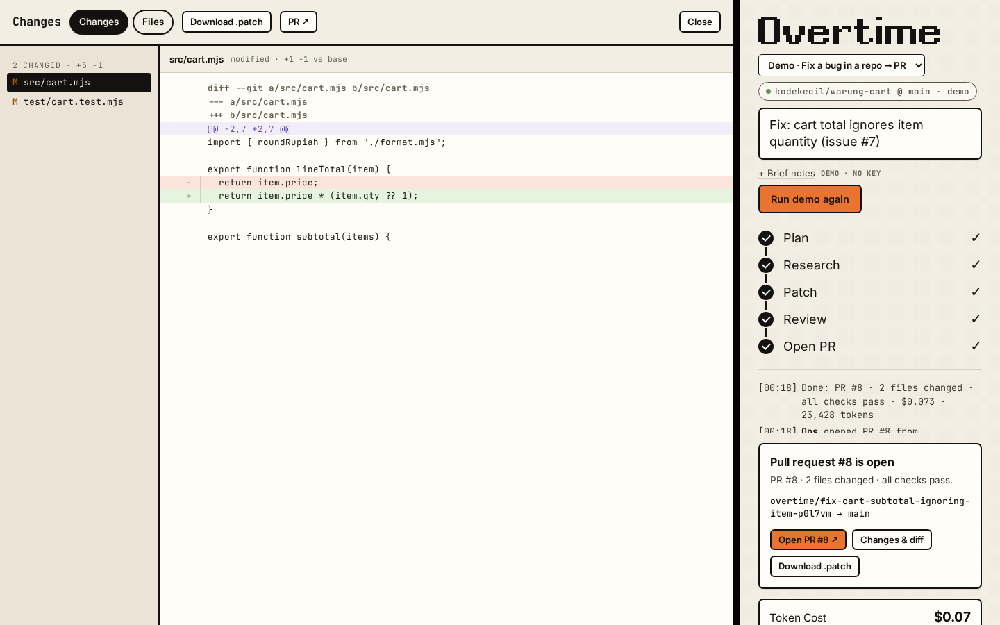 | 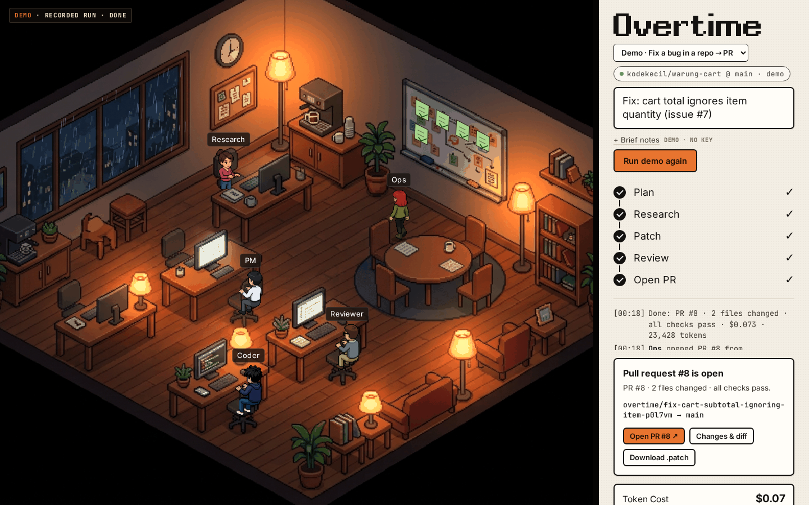 |

<p align="center">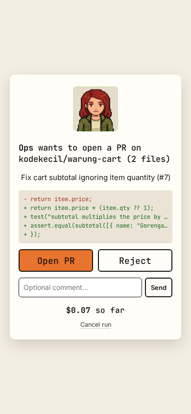 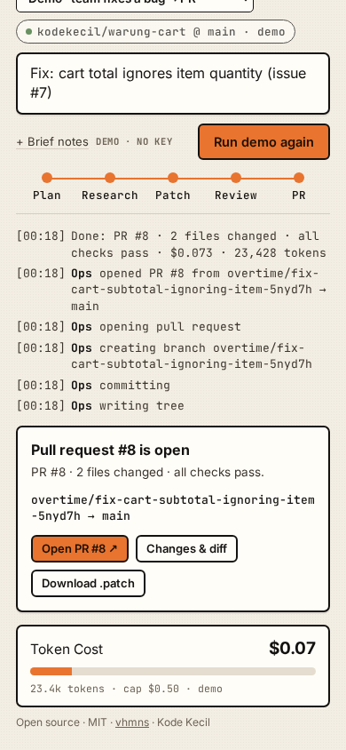 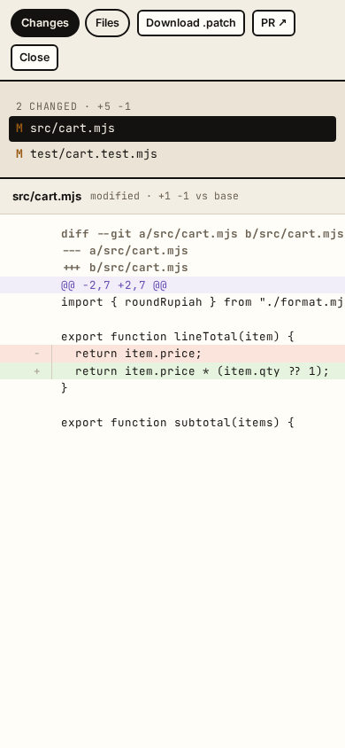</p>

<details><summary>Approved mockup vs. the real app</summary>

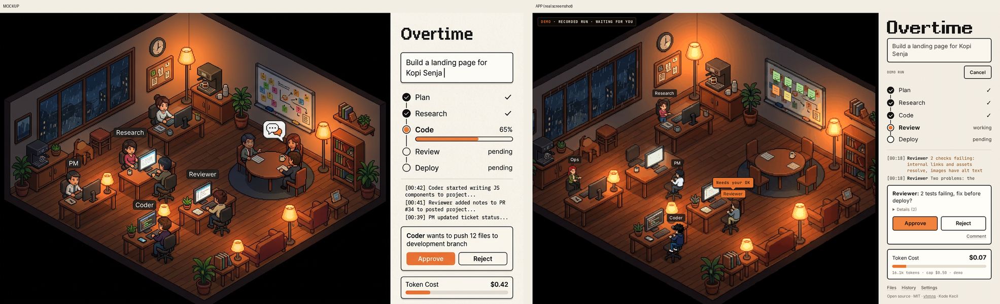
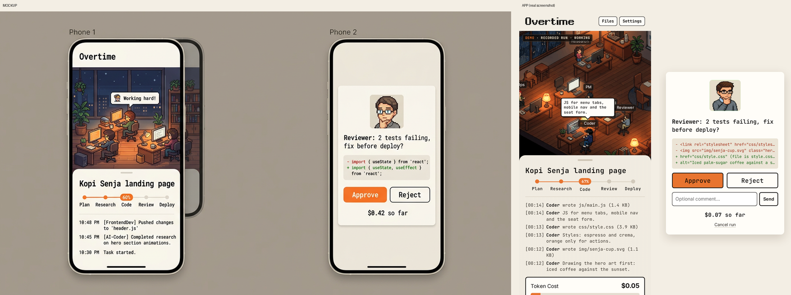

</details>

---

## Features of the built-in team

- **A live office.** Characters walk a nav graph between desks, the whiteboard, the meeting table and the coffee machine. Monitors glow while an agent types, lamps flicker and rain runs down the window. Click any agent to see its current thought, recent log, the files it touched and what it has spent.
- **Real work, end to end.**
  - **PM** writes the ticket list, which shows up as stickies on the whiteboard.
  - **Research** writes `notes/brief.md`. It can read one reference URL you give it, fetched through the Worker and handled strictly as data.
  - **Coder** writes multi-file static sites (HTML, CSS, JS, SVG).
  - **Reviewer** runs real automated checks and sends fixes back to the Coder (2 rounds at most).
  - **Ops** publishes a preview and offers a ZIP (site mode), or opens a pull request after your approval (repo mode).
- **Reviewer checks are deterministic, not vibes:**
  - HTML parse errors (parse5)
  - Broken internal links and assets, including CSS `url()` refs and in-page anchors
  - `alt` text, form labels, accessible names for buttons and links
  - Text contrast of 4.5:1 or better (reads CSS custom properties)
  - JS syntax, CSS syntax and a total size budget
  - Document basics (`lang`, `<title>`, viewport) as warnings
- **Approval gates** you can switch on or off: plan approval, when the Reviewer finds failures, and before deploy/push. Each gate offers Approve, Reject or Comment. Reject with a comment sends the feedback back to that agent, who redoes the step.
- **A side panel that follows the run:**
  - Step tracker: Plan, Research, Code %, Review, Deploy
  - Timestamped mono activity log
  - Approval card
  - Token cost meter in $ and tokens, with a per-agent breakdown on click
- **Repo mode: real pull requests on your repos.** Connect GitHub, pick a repo and base branch, describe the change.
  - **PM** reads the repo first: the recursive git tree (skipping `node_modules`, `dist`, lockfiles, binaries and huge files), the README, `package.json` and entry points. Its plan names the actual files it will touch.
  - **Research and Coder** read files on demand (`read_file`, fetched lazily and cached), `search_repo` paths and contents, and change code with `edit_file` search/replace patches that must apply cleanly, or nothing applies. `delete_file` always asks you first.
  - Everything is staged in a **virtual working tree**. The Changes view shows a git-style unified diff per file against the base commit, and you can download it as a `.patch`.
  - **Reviewer** runs real checks on the changed files: JS syntax (compiled, never run), a balance check for TS, JSON and `package.json` validity, the HTML/CSS checks for changed pages. It flags risky changes for your approval: `.github/` workflows, `.env`/keys/credentials, text that looks like a token, mass lockfile edits, deleted files, big deletions.
  - **Ops** asks before opening anything (this gate is always on in repo mode). On approval it creates `overtime/<slug>-<id>` from the exact commit the agents read, writes **one commit** through the git data API (blobs → tree → commit → new ref) and opens the PR. The title and body cover the task, plan, tickets, files changed, review results and token cost, and end with "Made with Overtime". Ops then pins the PR number on the whiteboard and celebrates.
  - **Never** pushes to the base branch, never force-pushes, never merges. The client has no code for it and the Worker proxy refuses it (see *Security*).
- **Phone layout.** The office sits on top with a bottom sheet below. Approvals open as a full-screen card with the agent's portrait, a diff snippet and the spend so far.
- **Files view.** File tree and code viewer, a version picker (Coder v1, v2…), a line diff against the previous iteration, a sandboxed preview iframe and a ZIP download.
- **Run history** (last 8 runs) is saved in `localStorage`. Settings live there too. It degrades to memory when storage is blocked.
- **Single-file offline build.** `npm run build:preview` produces `preview.html`: one inline classic `<script>` that runs all three demos (the recorded Hermes session first) inside a sandboxed iframe with no network and no storage. Insights work there too (replay, timeline, summary, costs; a GIF export shows inline since the sandbox blocks downloads).

## Quick start

```bash
npm install
npm run dev          # wrangler dev (Worker, offices, previews, proxy) on :8787 + Vite on :5173
# open http://localhost:5173 → "Connect Hermes", or pick "Demo · a recorded Hermes session"
```

Other scripts:

| Script | What it does |
|---|---|
| `npm run build` | Type-checks, then builds the app into `dist/` (served by the Worker's static assets) |
| `npm run dev:worker` | Serves `dist/` and the Worker together on :8787, the same way production does |
| `npm test` | Vitest unit tests: external-agent schema, redaction, Hermes payload mapping, HMAC verification, token auth, rate and size limits, the office Durable Object on real SQLite, the office reducer (roles, subagents, approvals, cost, sessions; a captured real Hermes run and the recorded demo); insights (session stats, cost per day/model/session with time zones, stuck heuristics, budgets and signal dedupe, replay timing at every speed, timeline filters and redaction, the GIF encoder round-trip, the insights endpoint); orchestrator (both modes), tool calls, checks, budget cap, approvals, injection safety, mocked GitHub (tree, patches, branch, commit, PR, error paths, token redaction), mocked LLM (JSON repair, tool calling fallback, 429 backoff, streaming), the smoke script |
| `npm run test:plugin` | pytest for the Hermes plugin: observer-only registration, privacy trimming, batching, timeouts, failure isolation |
| `npm run test:e2e` | Playwright at 390×844 and 1440×900 (Connect Hermes flow, live events, watch view, the demos, insights: replay controls, GIF/WebM export, timeline filter + jump, summary, cost dashboard + budget, stuck banner; 0 console errors). Run `npm run build` and `npm run build:preview` first. `OT_PORT=8797` runs it on another port |
| `npm run build:preview` | Builds `preview.html` (all demos, fully offline) and prints its sha256 |
| `npm run live:smoke` | A real end-to-end run from the terminal against your provider (and, optionally, your repo). See *Live smoke test* |
| `npm run atlas` | Rebuilds the sprite atlas and office background from `art/raw/` |
| `npm run deploy` | `wrangler deploy` to your own Cloudflare account. Nothing deploys unless you run it |

## Bring your own key

Open **Settings**, choose **Live (your key)**, then pick a preset or enter any OpenAI-compatible endpoint:

| Preset | Base URL | Default model | Route |
|---|---|---|---|
| OpenRouter (default) | `https://openrouter.ai/api/v1` | `openai/gpt-4o-mini` · free option: `openrouter/free` | Worker proxy |
| Groq | `https://api.groq.com/openai/v1` | `llama-3.3-70b-versatile` | Worker proxy |
| OpenAI | `https://api.openai.com/v1` | `gpt-4o-mini` | Worker proxy |
| Ollama (local) | `http://localhost:11434/v1` | `qwen2.5-coder:7b` | direct |
| Custom | any OpenAI-compatible `/chat/completions` | | either |

- **Test connection** makes one tiny call and shows the model the provider actually served, plus the latency.
- **Reply format.** *Auto* uses native **tool calling** (`tools` + `tool_choice: "required"`), steps down to **JSON mode** if the provider refuses tools, then to **plain prompting** if it refuses JSON mode. Almost-JSON replies (code fences, prose around the object, trailing commas, raw newlines, smart quotes, a missing closing brace) are repaired before the agent is asked again. Streaming is optional.
- **Retries.** 429, 408 and 5xx responses (including errors OpenRouter reports inside a 200) are retried with exponential backoff, honouring `Retry-After`. Retries show up in the activity log. 401/402 fail at once with a clear hint.
- **The key stays in your browser.** It lives in session storage unless you tick *Remember on this device*. Each request carries it as an `Authorization` header, either straight to the provider or through the Worker's stateless `/api/llm` proxy. The Worker never stores or logs it, and errors are redacted before they reach the activity log.
- **Prices and a budget cap.** Set the $/1M input and output tokens for your model, plus a budget cap per run (default $0.50). The run stops before it spends more.
- **Local Ollama:** use the *direct* route, or put `ALLOW_LOCAL_LLM=1` in `.dev.vars` so `wrangler dev` may proxy to `localhost`.

## Repo mode and GitHub

1. Pick **GitHub repo → pull request** in the task box (Live mode) and press **Connect GitHub…**.
2. Paste a **fine-grained personal access token** ([create one](https://github.com/settings/personal-access-tokens/new)):
   - Repository access: **Only select repositories** (just the ones Overtime may touch)
   - Permissions: **Contents: Read and write**, **Pull requests: Read and write** (Metadata: Read is added automatically)
3. Choose the repo and the base branch. Protected branches are fine as a base: Overtime never pushes to them.

**Where the token lives.** It stays in session storage (or local storage if you tick *Remember on this device*). Each GitHub call goes to the Worker's `/api/gh/*` proxy with the token in an `x-ot-gh-token` header. The Worker forwards it to `api.github.com` as `Authorization` and drops it; it never stores or logs it. You can switch the route to *direct* (the browser calls `api.github.com` itself).

**Errors you might see.** 401 (token wrong or expired), 403 (the token lacks Contents/Pull requests write on that repo), 404 (repo or branch not visible to the token), 409 (empty repo), 422 (branch exists, so Overtime retries with a new suffix; or a repository rule blocks branch creation), rate limits (the message says when the limit resets).

**OAuth later.** GitHub access goes through an `AuthProvider` interface (`src/engine/github.ts`). `PatAuth` is the only one today; an OAuth App or GitHub App flow only has to return a bearer token.

## Live smoke test

`npm run live:smoke` runs one real task from the terminal through the same engine, answering every gate automatically and printing it. Deletions are refused. Repo runs are dry (no branch, no PR) unless you opt in.

```bash
OVERTIME_LLM_BASE_URL=https://openrouter.ai/api/v1 \
OVERTIME_LLM_KEY=sk-or-... \
OVERTIME_LLM_MODEL=openai/gpt-4o-mini \
OVERTIME_BUDGET_USD=0.05 \
npm run live:smoke
```

| Variable | |
|---|---|
| `OVERTIME_LLM_BASE_URL`, `OVERTIME_LLM_KEY`, `OVERTIME_LLM_MODEL` | Provider, key (never printed) and model |
| `OVERTIME_BUDGET_USD` | Hard cap per run, default `0.05`. OpenRouter prices are looked up automatically; otherwise set `OVERTIME_PRICE_IN` / `OVERTIME_PRICE_OUT` ($ per 1M tokens) |
| `OVERTIME_TASK` | The task. Defaults to a small one-page site |
| `OVERTIME_LLM_OUTPUT` | `auto` (default), `tools`, `json` or `prompt` |
| `OVERTIME_GH_TOKEN` + `OVERTIME_GH_REPO=owner/name[@branch]` | Switches to repo mode, as a **dry run** that prints the diff |
| `OVERTIME_GH_OPEN_PR=1` | Actually creates the `overtime/…` branch, the commit and the PR |

Site output is written to `smoke-out/<run>/`. Behind an HTTP proxy, add `NODE_USE_ENV_PROXY=1` (Node 22.21+). The unit tests drive the same script against a mock provider and an in-memory GitHub.

## Architecture

```
src/
  engine/            framework-free, runs in the browser and in Node (tests)
    orchestrator.ts  PM → Research → Coder ⇄ Reviewer → Ops (site mode and repo mode); gates, budget, cancel/pause, events
    github.ts        GitHub REST client: AuthProvider (PAT today), tree/blob reads, one-commit PR flow, error mapping
    repo.ts          virtual working tree: ignore rules, lazy cached reads, search, search/replace patches, unified diffs
    repo-checks.ts   the Reviewer's repo checks + risk flags; repo-run.ts wires GitHub into the orchestrator
    schema.ts        JSON tool-call extraction + per-tool/per-role validation, safe paths
    prompts.ts       system prompts, per-phase context, <data> fencing of untrusted text
    checks.ts        the Reviewer's real checks (parse5, contrast, links, a11y, JS/CSS syntax, size)
    llm.ts           OpenAI-compatible client: tool calling → JSON mode → prompt fallback, streaming, 429 backoff, test connection
    diff.ts zip.ts storage.ts
  ext/               external agents: event schema v1, redaction, Hermes mapper, role rules, office reducer, HMAC/tokens, pricing
  insights/          replay clock, timeline, session stats + summary card, cost aggregations, budgets, stuck heuristics, signals (pure);
                     GIF encoder, frame composer + MediaRecorder export, SVG charts, and the Insights UI (ui.ts)
  demo/              recorded Hermes session; DemoLLM: recorded team runs (Kopi Senja; warung-cart bug fix → PR), FakeGitHub, mock OpenAI server
  office/            canvas renderer: pre-rendered isometric room + sprite atlas, nav graph, lights, rain
  app/               UI controller (vanilla TS), Hermes connect/live/watch (hermes.ts), settings, deploy/preview/GitHub
worker/src/          Cloudflare Worker + SQLite Durable Objects: one per preview, one per external-agent office (ext.ts)
integrations/hermes-overtime/   the Hermes plugin (plugin.yaml + __init__.py) and its pytest suite
art/raw/             generated source art; scripts/build-atlas.py slices + packs it
```

**Agent protocol.** Every model turn must be exactly one JSON object: `{"thought", "tool", "args"}` (or one native tool call, converted to the same shape). The tools are `write_file`, `read_file`, `list_files`, `run_checks`, `ask_user`, `handoff` and `finish`, plus `search_repo`, `edit_file` and `delete_file` in repo mode, and each role only gets its own subset. Long agent conversations stay within a context budget: big files come back as head + outline + tail with line ranges on request, and the oldest tool results are elided first. Replies are validated against a per-tool schema (required args, types, enums, size limits). An invalid reply is returned to the agent with a precise error, and three invalid replies in a row fail the run. Model calls get retries with backoff on 429/5xx, a 90 s timeout, an abort signal for cancel, and a step cap per agent. The Reviewer's verdict is grounded: when checks fail, the orchestrator sends the work back to the Coder whatever the model says.

**Worker routes:**

| Route | What it does |
|---|---|
| `GET /api/health` | Health check |
| `POST /api/llm` | Stateless OpenAI-compatible proxy. Public https upstreams only, private/loopback hosts refused |
| `GET/POST /api/gh/*` | Stateless GitHub proxy. Token from `x-ot-gh-token`, forwarded and dropped. Allowlist: reads, creating blobs/trees/commits, creating `refs/heads/overtime/*` refs, opening PRs. No PATCH/PUT/DELETE, no `force` |
| `GET /api/fetch?url=` | Read-only page fetch for Research. Public hosts only, 1 MB cap, returns stripped text |
| `PUT /api/runs/:id` | Stores the shipped files in that run's SQLite Durable Object. Validated paths, ≤80 files, ≤3 MB, expires after `PREVIEW_TTL_DAYS` through a DO alarm |
| `GET /p/:id/*` | Serves the preview with strict headers (see *Security*) |
| `POST /api/ext/runs` | Creates an external-agent office (SQLite Durable Object): office id, ingest token, view token, webhook secret |
| `POST /api/ext/runs/:id/events` · `/hermes` | Generic events · Hermes plugin batches. Bearer ingest token, validated, redacted, rate-limited |
| `POST /api/ext/hermes/webhook/:id` | Hermes outbound webhooks, HMAC-SHA256 (`X-Hermes-Signature-256`), 5-minute replay window, delivery dedupe |
| `GET /api/ext/runs/:id/events` · `/stream` | Replay for late viewers · live WebSocket (hibernatable). View or ingest token |
| `GET /api/ext/runs/:id/insights` | Model calls and session boundaries of the whole office for the cost dashboard and budgets. View or ingest token |
| `GET /hermes-overtime/*` | The plugin files, served by your own deployment for the Connect screen's curl lines |

**Why a custom canvas renderer instead of Phaser or Pixi?** The office is one pre-rendered isometric room with a handful of sprites, glows and rain. A ~600-line renderer covers that, keeps the bundle around 260 KB and makes the single-file classic-script preview possible. Bundled game engines don't survive that preview's constraints.

**Art.** The room, the five characters (idle, walk front and back, typing from behind, typing from the front, holding a coffee mug) and the portraits were generated as pixel art, chroma-keyed, then sliced. `scripts/build-atlas.py` downsamples with a box filter and a hard alpha, quantises each sprite's palette, removes green fringe and shelf-packs the atlas. Everything is drawn nearest-neighbour.

## Security notes

- **Prompt injection.** User notes, fetched pages and file contents are wrapped in `<data source="…">` blocks, with any attempt to close the fence stripped. Every agent is told that content inside `<data>` is untrusted and never contains instructions. Fetched pages go to Research only, never to the PM. Tool permissions are per role, so the PM and Ops cannot write files and Research can only write under `notes/`. Paths are normalised and anything that escapes the project is refused.
- **Preview isolation.** Generated sites are served from `/p/<runId>/` with:
  - `Content-Security-Policy: default-src 'none'; script-src 'self' 'unsafe-inline'; … connect-src 'none'; form-action 'none'; frame-ancestors 'self'; sandbox allow-scripts allow-forms`
  - `nosniff` and `no-referrer`
  - In the app, a `sandbox="allow-scripts allow-forms"` iframe with no `allow-same-origin`

  A generated page therefore can't read the app's storage (where a key may live), can't make network requests and can't navigate the top window. The in-browser fallback preview uses `srcdoc` with the same CSP.
- **GitHub writes are create-only.** The client only ever POSTs a new `overtime/…` ref, one commit and one PR. The Worker proxy enforces the same rule server-side: it forwards no PATCH, PUT or DELETE (so no ref moves, force-pushes, merges or deletions) and refuses ref creation outside `refs/heads/overtime/`.
- **Secrets.** API keys and GitHub tokens are never stored by the Worker; the proxies forward them in flight only (`Authorization` for the LLM, `x-ot-gh-token` → `Authorization` for GitHub). Nothing logs request bodies or headers. Worker errors never echo request data.
- **App CSP** (`public/_headers`): `default-src 'self'`, no inline scripts, `frame-ancestors 'none'`. It includes `'unsafe-eval'` for one reason: the Reviewer's JS syntax check *compiles* generated code with `new Function` and never calls it. Without eval, it falls back to a bracket/string/comment balance check.
- **SSRF.** The proxy and the fetcher refuse loopback, private, link-local and metadata hosts. Local LLMs need the explicit `ALLOW_LOCAL_LLM=1` dev flag.
- **External-agent offices.** Ingest and view tokens are random 24-byte values stored as SHA-256 hashes and compared in constant time; they open one office only. Hermes webhooks need a valid HMAC over the raw body and a fresh signed timestamp; repeated deliveries are dropped. Requests are capped at 256 KB and 200 events, offices are rate-limited, strings are clipped, secrets are redacted before storage, and the UI treats every payload as text (escaped). The Hermes plugin registers observer hooks only and cannot change what Hermes does; Overtime never answers approvals.

## Roadmap

- Streaming tokens into speech bubbles, and per-agent model choice (a cheap model for PM/Reviewer, a strong one for Coder)
- GitHub OAuth App / GitHub App sign-in (the `AuthProvider` seam is there), and running the repo's own tests in a sandbox before the PR
- More task types: small tools with tests
- Headless-browser checks (Lighthouse-style performance, real rendered contrast, screenshot diffs)
- Agents that can ask each other questions, plus a "standup" summary at the meeting table
- Day/night cycle, more office layouts, unlockable decor as runs complete
- Remote approvals for Hermes through its approval-transport API (the read-only `ApprovalTransport` seam is in place), streaming Hermes' replies into speech bubbles
- Adapters for more agents on the generic events API (Claude Code hooks, OpenAI Agents SDK tracing)
- Shareable read-only replays of built-in team runs (external-agent offices already have them)
- Server-side stuck/budget checks in the office Durable Object, so notifications work with no browser open (the detectors are already pure)

## License

MIT © vhmns · Kode Kecil
